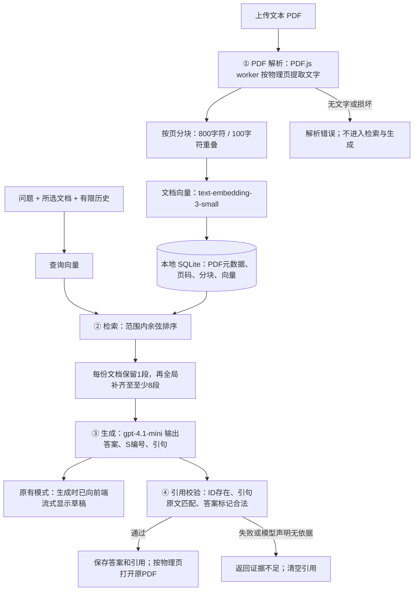
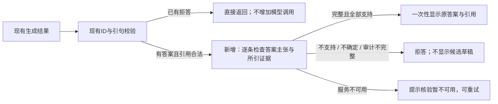

# DocuChat：回答与引用可靠性评估

> 历史实验记录：下述数据与流程使用原向量检索。后续单独完成了[跨页检索实验](RETRIEVAL_EVALUATION.md)，现在默认启用相邻页扩展；要复现本报告基线需 `RETRIEVAL_MODE=vector`。本报告的评估脚本已固定原检索，历史结果未改写。

2026-10-18（America/Los_Angeles；原始记录使用 UTC）。本轮只新增一种机制：**生成后的证据支持检查**。结果未显示整体正确性提高，因此 `EVIDENCE_CHECK` 默认关闭，保留为可复现实验。

**结论：真实引用不一定支持结论；检查器也可能重复生成模型的错误。** 27道文本问答中，内容正确且完整为22题，改动前后相同。新增检查把一道跨页题的不完整回答变为拒答，但未找回缺失证据，也未拦住两道错误推理。第28题是空白 PDF 的解析边界测试，按预期在模型调用前被拦截。

[28题逐题记录](docs/evaluation/cases.md) · [CSV](docs/evaluation/cases.csv) · [原始调用与回答](docs/evaluation/evidence-run.json) · [评审判定](docs/evaluation/review.json) · [汇总数据](docs/evaluation/summary.json)

## 现有流程：四个环节在哪里发生

以下为基线 `349414f` 的流程；关闭实验开关时仍使用这条路径。



| 环节 | 代码位置 | 输入与输出 | 已有能力的边界 |
| --- | --- | --- | --- |
| PDF解析 | [pdf-worker.js](backend/pdf-worker.js)、[pdf.js](backend/pdf.js) | PDF字节 → 按页文字 → 带 `documentId/page/chunkId` 的分块 | 不做OCR；物理页码不等于印刷页码；本轮未覆盖双栏、表格、复杂扫描件 |
| 检索 | [memory.js](backend/memory.js) 的 `retrieveMany`；[app.js](backend/app.js) 的 `/api/chat` | 问题向量 + 所选文档索引 → S1…Sn片段 | 每份文档先保留1段，再补齐至 `max(8, 文档数×2)`；没有跨页追索或重排 |
| 生成 | [provider.js](backend/provider.js) 的 `generate` | 问题、有限历史、检索片段 → JSON答案和模型选定引句 | 历史仅用于指代；模型仍可能接受错误前提、忽略冲突或遗漏问题部分 |
| 引用 | [citations.js](backend/citations.js) 的 `validateAnswer`；[Sources.jsx](frontend/src/components/Sources.jsx) | 模型选择ID和引句；后端绑定真实页码；前端展示 | 校验真实性与归属，不证明逻辑支持；不会给出校准置信度 |

## 唯一新增机制



[evidence-check.js](backend/evidence-check.js) 使用同一个聊天模型，另发一次结构化请求，仅提供问题、候选答案、引用ID、来源名称和**已校验的引句**。它检查每条事实、数量、比较和推论是否有引用支持。没有添加第二轮检索、重排、OCR、答案重写或自动修复，也没有改变原有生成提示词。

结构不完整、空主张列表、未知引用、`uncertain`、`unsupported` 都不能通过。已有拒答跳过检查。启用时先缓冲候选答案，防止拒绝的内容已经被流式展示；取消、超时、删除来源和清空会话仍会中止流程。API失败显示“暂时无法核验证据”，不冒充“文档中不存在答案”。审计的详细主张不写入聊天记录，只保存检查状态及独立耗时/token指标。

开启方式：真实模式下，在 `backend/.env` 设置 `EVIDENCE_CHECK=true`，重启后端。关闭为 `false`，无需重建索引。Mock演示没有真实证据判断能力，请保持此选项关闭。界面“已通过模型证据检查”表示模型判定，**不是事实保证**。

## 测试设计与评分

- 固定28题：[测试集](eval/evidence-cases.json)。19道在完整所选文档内可回答，8道没有充分答案，另1道空白PDF解析测试。标签可重叠，其中8道双语题包含中文问英文原文和显式英文回答要求。
- 使用4份纯虚构文本PDF，共22页，加1份空白PDF；原文由 [materials.json](eval/materials.json) 生成。问题覆盖跨页、跨文档、相似编号、错误前提、冲突、缺失事实和文档内恶意指令样例。不发送个人PDF或本地配置。
- **配对对照**：每题只解析/检索/生成一次。改动前结果是同一候选经原有引用校验；改动后再经过新增检查。避免两次生成的随机差异，但这不是两组独立实验，也不能测量多轮历史被拒答改变后的长期效果。
- 模型别名 `gpt-4.1-mini`、`text-embedding-3-small`；temperature=0，生成输出上限900 token，核验1600 token；重试0次，每请求120秒上限，费用预算1美元。原始记录含测试集、材料和相关代码的SHA-256。别名可能随服务变化；未记录服务返回的具体模型快照。
- **内容正确且完整**：符合预先写定的参考事实，不漏掉所问关键内容；可回答问题的拒答算失败，无答案问题的正确拒答算通过。语言合规单独记录，“任务通过”同时要求两者。
- **引用支持**：逐条对照实际展示的事实与引句；无答案的行记为不适用，不把没有引用算作引用成功。原文锚点命中仅是解析/检索覆盖指标，不代替语义评审。
- 评分由Codex助手读取固定标准、完整原文和输出后逐题完成，**并非独立人工评审，且未盲评**。检查器的通过/拒绝不用于给自身算正确率。判定与原始记录分别保存，可以复核并修改评分。

## 改动前后结果

| 指标 | 原有流程 | 增加证据检查 | 解读 |
| --- | ---: | ---: | --- |
| 内容正确且完整（文本问答） | 22/27，81.5% | 22/27，81.5% | 没有提升 |
| 任务通过（含语言要求） | 21/27，77.8% | 21/27，77.8% | E09仍用错回答语言 |
| 全部用例通过（含解析边界） | 22/28，78.6% | 22/28，78.6% | 空白PDF预期拦截通过 |
| 已回答内容的引用充分支持 | 16/19，84.2% | 16/18，88.9% | 分母减少；不是新增正确答案 |
| 原文无答案时正确拒答 | 7/8 | 7/8 | E23仍接受“每箱37升”的错误前提 |
| 可回答问题被拒答 | 1/19 | 2/19 | 新增E11拒答，没有找回其答案 |
| 实际给出答案 | 19/27 | 18/27 | 覆盖率下降；未丢失原本完整正确的答案 |
| 平均完成时间 | 1.338秒 | 2.294秒 | 增加0.956秒，约71% |
| 中位完成时间 | 1.205秒 | 2.384秒 | 包含免核验的拒答题 |
| P95完成时间 | 2.619秒 | 4.531秒 | nearest-rank，单次本机测量 |
| 27题估算API费用 | $0.0091541 | $0.0165837 | 增加$0.0074296，约81% |

只新增了19次检查；8题已有拒答，无额外核验调用。4份文本材料的公共索引费用约$0.00001694，单独计费，不重复计入每题对照。实际总费用估算为 **$0.01660064**；是token×公开单价估算，不是账单结算金额。生成15731输入/1783输出token，检查8882输入/2423输出token，文档与问题向量合计1292 token，缓存输入为0。

价格口径：标准API的GPT-4.1 mini输入$0.40/百万token、缓存输入$0.10、输出$1.60；text-embedding-3-small输入$0.02/百万token，见 [聊天模型价格](https://developers.openai.com/api/docs/models/gpt-4.1-mini) 与 [向量模型价格](https://developers.openai.com/api/docs/models/text-embedding-3-small)。收费失败或usage缺失时脚本保留预算预留值，不按免费处理；本次没有缺失usage。

耗时是端到端本机HTTP测量。基线时间取同次请求完成生成与原有校验的时点，改后时间取请求完成；包括网络等待、查询向量与生成，不含预先建立文档索引。检查模式会推迟首次可见答案，**未测浏览器首字渲染或并发负载性能**。28题仅单次运行，不进行显著性推断。

## 失败原因与容易答错的问题

| 环节 | 用例 | 可复核证据 | 新机制的效果 |
| --- | --- | --- | --- |
| 解析 | E28预期边界；未观察到解析缺陷 | 27/27人工指定原文锚点成功解析；空白PDF返回422/PDF_NO_TEXT | 没有模型调用；不把空白PDF错误算作模型拒答 |
| 检索 | E11、E12 | MX-17 → CobaltWorks 在第3页，CW-8842 在第4页。第4页已解析，但8个检索片段被相似维护公告挤占；锚点检索25/27 | 检查无法补回缺失页；英文题拒答，中文题仍给出不完整答案 |
| 生成 | E05、E23 | 冲突温度自行选18°C为权威；将项目37升×6箱算成手册规定222升 | 两道错误推理都被核验器放行 |
| 生成 | E09、E11、E12 | 语言不符合问题；跨页题只回答供应商，不给零件号 | 没有增加完整正确答案 |
| 引用格式 | E13 | 事实正确且正确页已检索，但模型引句包含字面反斜杠换行转义，与原文不符 | 原有校验已经拒绝；新机制跳过，仍丢失正确回答 |
| 引用支持 | E05、E11、E23 | 引句来自真实文档，但不支持“原版优先”“整份文档未给编号”“每箱37升” | E11改为拒答；另两题仍错 |

E11的检查输出还存在内部不一致：总体 `unsupported`，逐条主张却都为 `supported`。代码保守拒绝了该结果，但不能据此说检查器给出了可靠的错误解释。E12则说明：**部分事实有引用，不等于回答完整**。这轮未针对失败样本反复改提示词、挑选更好的结果或追加第二种机制。

## 何时应该拒答

1. PDF没有可提取文字、损坏或未完成索引：先报告解析/索引问题，不能冒充文档问答。
2. 所选文档没有事实、问题越出范围，或推理缺少必要前提：不补常识和猜测。已知部分可以说明，但应明确未知部分。
3. 引用ID、引句或归属不合法：拒绝候选答案。E13表明这种保护也会造成误拒答，需要单独统计。
4. 文档冲突且没有优先级：应描述双方依据并说明无法确定，不能擅自选一个版本。
5. 启用实验检查时，证据不支持、无法判断或审计结构不完整：保留拒答；核验服务错误应提示重试。

第2、4点是预期行为；E05、E23说明现有模型和本次检查仍未完全做到。没有可靠的数值置信度阈值，不能把模型自报“支持”解释为校准概率。

## 复现与后续选择

```bash
npm ci
npm test
npm run eval:evidence:offline
# 配好真实API密钥、MOCK_AI=false后（会收费）：
npm run eval:evidence -- --allow-paid --budget-usd=1
# 复核已归档的这一轮结果，不调用模型：
node scripts/report-evidence.js
```

真实重跑写入忽略的 `eval/results/evidence-real.json`，不会覆盖本次归档。评分文件绑定原始JSON的SHA-256；新结果必须重新评审。离线模式只验证管线、费用台账和输出格式，不能作为质量成绩。正常CI不使用密钥或付费调用。

当前选择：保留检查开关默认关闭。本轮没有改善端到端正确性，反而增加费用、等待和拒答。下一轮应另做单一变量实验，优先测试跨页证据召回；同时加入真实版式和独立人工评审。这里仅记录建议，**本轮没有实现第二种机制**。

工程验证：49个自动测试、5个浏览器测试、语法检查、生产构建及28题离线流程均通过。构建仍提示已有大包与Ant Design `use client` 指令警告；没有将其描述为零警告。全部测试与费用记录不构成“完全没有问题”或适用于任何PDF的保证。
