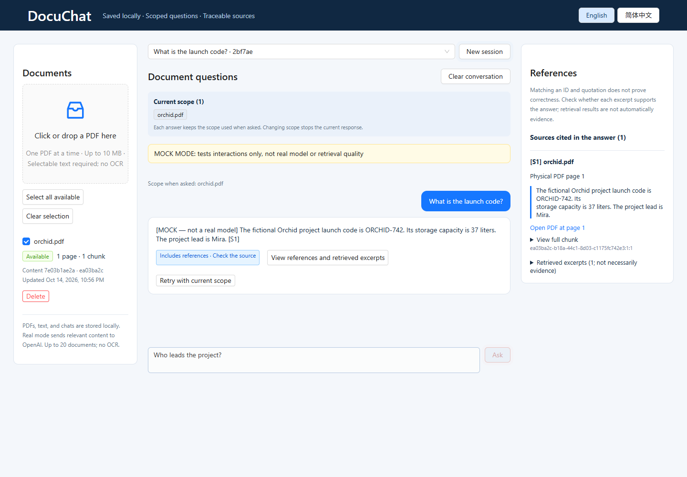
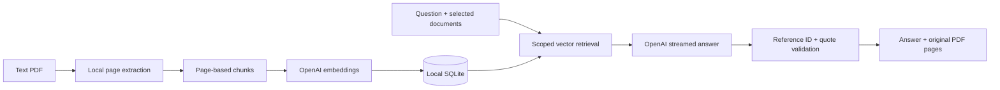

<div align="center">

# DocuChat

### Your documents. Clear answers. Sources you can inspect.

A local PDF workspace with persistent conversations, scoped retrieval, streaming answers, and page-level references.

[](https://nodejs.org/)
[](https://react.dev/)
[](LICENSE)

**English** · [简体中文](README.zh-CN.md)

[Quick start](#quick-start) · [Architecture](#how-it-works) · [Privacy](#privacy-and-data) · [Documentation](#documentation)

</div>



<p align="center"><sub>Offline demo with a fictional PDF. Mock mode returns a retrieved excerpt; this is not a real model evaluation.</sub></p>

## Built around the source

| Capability | What it means in practice |
| --- | --- |
| **A persistent library** | PDFs, indexes, and conversations survive restarts. Compatible duplicate uploads reuse their index. |
| **Explicit search scope** | Ask within one document, a selection, or the available library. Each question keeps its own scope. |
| **Inspectable references** | Read quoted passages, filenames, and physical PDF page numbers. Open the original PDF at the cited page. |
| **Streaming with control** | Watch answers arrive, stop generation, retry failed work, and switch conversations safely. |
| **English and Chinese** | Change the interface language without resetting documents, drafts, or conversations. |
| **A key-free demo** | Exercise the workflow offline with fictional fixtures and an explicitly labeled mock provider. |

## Quick start

Requires **Node.js 24.x** and npm. No Docker or database server is needed.

```bash
git clone https://github.com/yiksu1312/DocuChat.git
cd DocuChat
npm ci
```

### Try it offline

**PowerShell**

```powershell
$env:MOCK_AI='true'
$env:OPENAI_API_KEY=''
npm run dev
```

**macOS / Linux**

```bash
MOCK_AI=true OPENAI_API_KEY='' npm run dev
```

Open **http://127.0.0.1:5173**, upload [`fixtures/orchid.pdf`](fixtures/orchid.pdf), and ask **“What is the launch code?”** Open a reference to inspect the original page.

Mock mode exercises the interaction and retrieval pipeline. It echoes a retrieved passage and does not establish model reasoning or answer quality.

### Connect OpenAI

Start a fresh terminal so the mock settings above are no longer active. Copy the empty configuration template:

```powershell
# PowerShell
Copy-Item backend/.env.example backend/.env
```

```bash
# macOS / Linux
cp backend/.env.example backend/.env
```

Set `OPENAI_API_KEY` in `backend/.env`, then run `npm run dev`. Keep credentials on the backend; never use a `VITE_` variable for a secret. Indexing and real questions can incur API charges.

For a built local application, stop development services and run:

```bash
npm run build
npm start
```

Open **http://127.0.0.1:5001**. Stop with Ctrl+C; restart with the same data directory to restore your workspace.

## How it works



React / Ant Design connects to a loopback-only Express API. PDF.js extracts text in a worker; LangChain text splitters preserve page boundaries. SQLite stores documents, vectors, and conversations; cosine retrieval runs in-process. Before saving a final answer, the backend checks citation identifiers and quoted text against retrieved passages.

**A matching quotation does not prove that every claim is supported.** Inspect the source when accuracy matters. Recent conversation is context, not evidence.

## Privacy and data

| Stays on your machine | Sent to OpenAI in real mode |
| --- | --- |
| Original PDFs; SQLite database; saved chats and indexes | Document chunks for embeddings; retrieval queries; questions, bounded conversation context, source names, and retrieved passages for answers |

PDF bytes are parsed locally. Real mode is **not fully offline**. Mock mode makes no AI-provider calls.

Local storage is plaintext. Deleting a document removes its PDF and index and strips saved source quotations, but preserves past answers; clear conversations separately when needed. See [storage and backups](STORAGE.md).

The server binds to `127.0.0.1`, validates local Host / Origin headers, and disables API response caching. It has **no user authentication** and is intended for one user on a trusted machine. Do not expose it through public hosting, tunnels, or a reverse proxy.

## Configuration

Process environment variables override `backend/.env`. Blank optional values use the defaults below.

| Variable | Default | Purpose |
| --- | --- | --- |
| `OPENAI_API_KEY` | Empty | Backend-only provider credential |
| `CHAT_MODEL` | `gpt-4.1-mini` | Structured streaming answers |
| `EMBEDDING_MODEL` | `text-embedding-3-small` | Document and query vectors |
| `DATA_DIR` | `data/openai` or `data/mock` | Persistent directory; an absolute override is recommended |
| `PORT` | `5001` | Backend port |
| `MODEL_TIMEOUT_MS` | `60000` | Indexing / question deadline |
| `MODEL_MAX_RETRIES` | `1` | Maximum SDK retries |
| `MOCK_AI` | `false` | Explicit offline demo |

If you change `PORT`, set `BACKEND_PORT` to the same value when starting the frontend. Keep mock and real data separate. Changing embedding or split settings requires explicit reindexing and may incur API charges.

## Development and verification

```bash
npm test                 # API, storage, cancellation, security regressions
npm run check            # JavaScript syntax checks
npm run build            # Production frontend build
npm run test:browser     # Browser workflows and bilingual UI
npm run eval:offline     # Deterministic retrieval and pipeline checks
```

Local browser tests use Microsoft Edge by default. For bundled Chromium, run `npx playwright install chromium` and set `CI=1` for the test command. GitHub Actions uses Chromium.

See [validation details](VALIDATION.md) for measured results and limits. Paid evaluation scripts require `--allow-paid`; routine tests make no paid API calls.

```text
backend/     Express API, PDF workers, retrieval, providers, SQLite
frontend/    React workspace, source panel, bilingual resources
tests/       API, persistence, recovery, security, browser tests
fixtures/    Fictional PDFs for reproducible demos
eval/        Evaluation cases and synthetic source material
scripts/     Validation, backup, and release utilities
docs/        Screenshots and release manifest
```

## Scope and limits

- Text PDFs only; no OCR. Up to **20 documents**, **10 MB / 200 pages / 300,000 extracted characters** each.
- Up to **2 indexing jobs** and **4 answers** concurrently. Designed for small local collections.
- SQLite uses Node's built-in `node:sqlite`, experimental in the tested Node release.
- No calibrated confidence score or guarantee of semantic correctness. PDF page links depend on the browser viewer.

## Documentation

[API](API.md) · [Storage & backup](STORAGE.md) · [Design decisions](DESIGN.md) · [Five-minute walkthrough](ACCEPTANCE.md) · [Contributing](CONTRIBUTING.md) · [Security](SECURITY.md)

## License

[MIT](LICENSE). Third-party dependencies retain their own licenses; see [dependency notices](docs/dependency-licenses.json).
