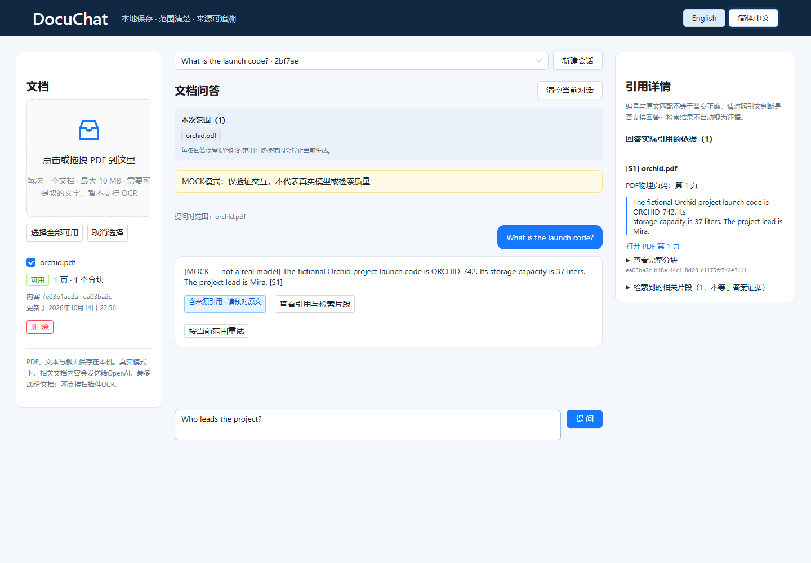

<div align="center">

# DocuChat

### 围绕文档提问，让回答有据可查。

本地 PDF 问答工作台：持久化文档与对话、限定检索范围、流式回答，以及可打开原文的页级引用。

[](https://nodejs.org/)
[](https://react.dev/)
[](LICENSE)

[English](README.md) · **简体中文**

[快速开始](#快速开始) · [隐私与数据](#隐私与数据) · [开发与验证](#开发与验证)

</div>



<p align="center"><sub>截图使用虚构 PDF 与离线 Mock 模式。Mock 返回检索片段，不代表真实模型的回答质量。</sub></p>

## 从回答回到原文

| 功能 | 实际体验 |
| --- | --- |
| **持久化文档库** | 重启后恢复 PDF、索引和对话；相同内容且配置兼容的文件复用索引。 |
| **明确检索范围** | 在单份、多份或全部可用文档内提问，每次请求固定自己的范围。 |
| **可核查引用** | 展示引句、文件名和 PDF 物理页码，直接打开相应页面。 |
| **可控流式回答** | 实时查看生成进度、停止回答、重试失败任务，并安全切换会话。 |
| **中英双语** | 切换界面语言时保留文档、草稿和已有对话。 |
| **无需密钥的演示** | 使用虚构样本与明确标注的 Mock 模式，离线体验完整流程。 |

## 快速开始

需要 **Node.js 24.x** 和 npm，无需 Docker 或独立数据库服务。

```bash
git clone https://github.com/yiksu1312/DocuChat.git
cd DocuChat
npm ci
```

### 先试试离线模式

**PowerShell**

```powershell
$env:MOCK_AI='true'
$env:OPENAI_API_KEY=''
npm run dev
```

**macOS / Linux**

```bash
MOCK_AI=true OPENAI_API_KEY='' npm run dev
```

打开 **http://127.0.0.1:5173**，上传 [`fixtures/orchid.pdf`](fixtures/orchid.pdf)，输入 **“What is the launch code?”**，再打开引用查看原文。

Mock 模式验证交互与检索流程，只返回检索片段，不代表真实模型的推理或回答质量。

### 接入 OpenAI

打开新的终端，避免沿用刚才的 Mock 环境变量，然后复制空配置模板：

```powershell
# PowerShell
Copy-Item backend/.env.example backend/.env
```

```bash
# macOS / Linux
cp backend/.env.example backend/.env
```

在 `backend/.env` 中填写 `OPENAI_API_KEY`，执行 `npm run dev`。密钥仅放在后端，切勿写进前端或 `VITE_` 变量。真实索引与问答会产生 API 费用。

使用构建后的本地应用时，先停止开发服务：

```bash
npm run build
npm start
```

打开 **http://127.0.0.1:5001**。用 Ctrl+C 停止；再次启动时使用同一数据目录即可恢复工作台。

## 工作原理

React / Ant Design 界面连接仅监听本机的 Express API。PDF.js 在 worker 中提取文本，LangChain 分块器保留页边界；SQLite 保存文档、向量与会话，进程内余弦检索选取相关片段。保存最终回答前，后端核对引用 ID 与引句是否来自本次检索结果。

**引句匹配不等于每个结论都得到支持。** 对准确性有要求时，请核查原文。近期对话只用于理解上下文，不作为证据。架构图见 [English README](README.md#how-it-works)。

## 隐私与数据

| 保存在本机 | 真实模式下发送至 OpenAI |
| --- | --- |
| 原始 PDF、SQLite 数据库、聊天记录和索引 | 用于向量化的文档分块与检索查询；用于回答的问题、有限历史、来源名称及检索片段 |

PDF 在本地解析。真实模式**不是完全离线**；Mock 模式不调用 AI 服务。

本地数据以明文保存。删除文档会删除 PDF、索引及已保存的来源引句，但保留历史回答；需要时应另外清空会话。详见[存储与备份](STORAGE.md)。

服务绑定 `127.0.0.1`，校验本机 Host / Origin，并禁用 API 响应缓存。项目**不含用户认证**，仅面向可信设备上的单人使用，不适合直接暴露到公网、隧道或反向代理。

## 配置

进程环境变量优先于 `backend/.env`；可选项留空时使用默认值。

| 变量 | 默认值 | 用途 |
| --- | --- | --- |
| `OPENAI_API_KEY` | 空 | 仅后端使用的服务密钥 |
| `CHAT_MODEL` | `gpt-4.1-mini` | 结构化流式回答 |
| `EMBEDDING_MODEL` | `text-embedding-3-small` | 文档与问题向量 |
| `DATA_DIR` | `data/openai` 或 `data/mock` | 持久化目录；自定义时建议使用绝对路径 |
| `PORT` | `5001` | 后端端口 |
| `MODEL_TIMEOUT_MS` | `60000` | 索引与问答截止时间 |
| `MODEL_MAX_RETRIES` | `1` | SDK 最大重试次数 |
| `MOCK_AI` | `false` | 显式离线演示模式 |

修改 `PORT` 时，启动前端需将 `BACKEND_PORT` 设为相同值。真实与 Mock 数据目录应分开；向量模型或分块配置变化后需显式重建索引，可能产生 API 费用。

## 开发与验证

```bash
npm test                 # API、存储、取消与安全回归
npm run check            # JavaScript 语法检查
npm run build            # 前端生产构建
npm run test:browser     # 浏览器流程与双语界面
npm run eval:offline     # 确定性的检索与流程检查
```

本地浏览器测试默认使用 Microsoft Edge。也可执行 `npx playwright install chromium`，并在运行测试时设置 `CI=1` 使用 Chromium。GitHub Actions 使用 Chromium。

实际结果与验证边界见 [VALIDATION.md](VALIDATION.md)。付费评估脚本要求显式传入 `--allow-paid`；常规测试不产生付费 API 调用。

## 适用范围

- 仅支持文本 PDF，不含 OCR。最多 **20 份文档**，单份最多 **10 MB / 200 页 / 300,000 字符**。
- 最多同时处理 **2 个索引任务**与 **4 个回答**，面向小型本地文档集合。
- 使用 Node 内置 `node:sqlite`，在测试所用版本中仍标记为实验性功能。
- 不提供校准置信度或语义正确性保证。PDF 页码跳转取决于浏览器查看器。

## 项目文档

[API](API.md) · [存储与备份](STORAGE.md) · [设计取舍](DESIGN.md) · [五分钟体验](ACCEPTANCE.md) · [贡献指南](CONTRIBUTING.md) · [安全说明](SECURITY.md)

## 许可证

[MIT](LICENSE)。第三方依赖保留各自许可证，详见[依赖声明](docs/dependency-licenses.json)。
