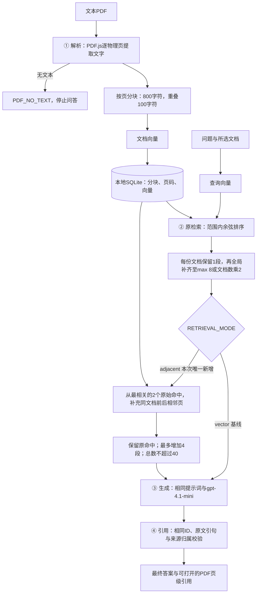

# DocuChat：跨页检索单变量实验

2026-10-18（America/Los_Angeles；原始记录使用 UTC）。本轮只增加**有界相邻页扩展**，默认启用 `RETRIEVAL_MODE=adjacent`，可设 `vector` 回到原检索。上一轮的证据检查仍默认关闭，本次两组也均关闭。

**同一批28题中，两道原先漏掉关键页的中英文问题均得到完整答案和两页引用；没有观察到其他题的正确性退步。** 27道文本问答的内容正确且完整从23题增至25题；计入语言要求与空白PDF边界后，全部用例通过从23/28增至25/28。这是一次针对已知失败的修复验证，不是独立泛化测试，也不是“所有跨页问题已解决”。

[28题逐题记录](docs/retrieval-evaluation/cases.md) · [CSV](docs/retrieval-evaluation/cases.csv) · [完整原始输出](docs/retrieval-evaluation/retrieval-run.json) · [评分判定](docs/retrieval-evaluation/review.json) · [汇总](docs/retrieval-evaluation/summary.json) · [上一轮实验](EVIDENCE_EVALUATION.md)

## 流程与唯一改动



| 环节 | 位置 | 本轮处理 |
| --- | --- | --- |
| PDF解析、分块 | [pdf.js](backend/pdf.js)、[pdf-worker.js](backend/pdf-worker.js) | 保持原样；未增加OCR或跨页拼接 |
| 检索 | [memory.js](backend/memory.js) `retrieveMany` | 唯一行为变化：原候选后追加相邻页片段 |
| 生成 | [provider.js](backend/provider.js) `generate` | 提示词、模型、温度和输出上限保持原样 |
| 引用 | [citations.js](backend/citations.js)、[app.js](backend/app.js) | 原有引用格式和来源校验保持原样；语义证据检查两组都关闭 |

原检索按查询相似度取片段。第3页说明 **MX-17 → CobaltWorks**，第4页说明 **CobaltWorks → CW-8842**。第4页没有出现问题中的泵型号，排名被多份含型号的相似维护公告挤出；解析和存储中实际存在这一页。

新机制先保留原有结果和S编号，取其中余弦分数最高的两个**原始**片段作为起点。每个起点只查看同一文档物理页码 `page-1` 与 `page+1`，每个相邻页选查询相似度最高的一段，重复项跳过。新增片段不能继续扩展，最多增加4段，总数不超过40。相邻页不存在或为空就跳过；不跨文档找“相同页码”。20份文档已达到原上限时不继续追加。

这不增加模型调用，不重建向量索引；只增加生成上下文。没有重排、查询改写、第二轮搜索、生成后修复或新的拒答规则。`RETRIEVAL_MODE=vector` 可回退，重启即可生效，无需重新上传PDF。

## 对照设计

- 原样使用 [evidence-cases.json](eval/evidence-cases.json) 中的28题及 [materials.json](eval/materials.json)：19道可回答、8道无充分答案、1道空白PDF边界；包含8道双语题。没有针对结果修改题目、标准或材料。
- 4份虚构文本PDF共22页只解析、建索引一次，两组共享；空白PDF也只解析一次。每道文本题的两组均单独创建空会话，完整调用 `/api/chat`，不重放生成结果。
- 奇数题先 `vector` 再 `adjacent`，偶数题反过来，顺序执行。两组 `EVIDENCE_CHECK=false`；生成 `gpt-4.1-mini`、向量 `text-embedding-3-small`、temperature=0、输出上限900 token、重试0、每请求120秒、总预算上限1美元。
- 脚本对照上一轮归档，核对题目、材料、解析器、生成器和引用校验文件的哈希（允许Git换行符差异）；归档包含本轮代码哈希与每次调用的usage、耗时、费用、候选答案和最终响应。
- 分别重新调用查询向量API，20/27题向量哈希逐字节相同，7题不同；**全部27题的原始检索命中及顺序仍相同**。6题上下文因相邻页扩展而增加：E08、E11、E12、E13、E14、E26，其余21题上下文完全相同。目标E11/E12的查询向量也相同。
- 内容评分要求事实正确且完整，无答案时适当拒答；可回答题的拒答算失败。语言单独计分。引用充分性只评估实际陈述的事实，不把“部分事实有依据”算作完整回答；无事实答案记为不适用。评分来自助手对54份输出、引句、完整原文与固定标准的逐题复核，**非盲评，未经独立人工确认**。

## 改动前后结果

| 指标 | 原检索 vector | 相邻页扩展 adjacent |
| --- | ---: | ---: |
| 内容正确且完整：27道问答 | 23/27，85.2% | **25/27，92.6%** |
| 问答任务通过：同时要求语言合规 | 22/27，81.5% | **24/27，88.9%** |
| 全部用例通过：再加解析边界 | 23/28，82.1% | **25/28，89.3%** |
| 所需原文锚点检索命中 | 25/27 | **27/27** |
| 已回答内容的引用充分支持 | 17/20，85% | 18/20，90% |
| 原文无答案时处理正确 | 7/8 | 7/8 |
| 可回答题被拒答 | 0/19 | 0/19 |
| 平均完成时间 | 1.377秒 | 1.358秒 |
| 中位完成时间 | 1.313秒 | 1.307秒 |
| P95完成时间，nearest-rank | 1.651秒 | 1.881秒 |
| 27题估算API费用 | $0.0091461 | $0.0090129 |
| 生成输入 / 输出token | 15,731 / 1,778 | 16,054 / 1,614 |
| 查询向量调用 / 生成调用 | 27 / 27 | 27 / 27 |

内容正确率增加**7.4个百分点**。改善只有E11和E12，均回答 **CW-8842** 并同时引用第3页和第4页。两组没有其他内容正确性变化；E12原来的部分事实也有充分引用，所以引用支持率只增加1题，完整回答数增加2题。

**不要把本轮微小的时间和费用下降解释为机制保证更快、更便宜。** 平均耗时下降约1.4%，但P95上升约13.9%。输入多323 token（约2.1%），输出少164 token（约9.2%），本次净费用下降约1.5%；主要原因是E12不再生成冗长的无关公告引文。扩展一般会增加输入费用；网络和模型生成也有波动。没有测浏览器首字显示、并发负载或多次运行置信区间。

费用按实际usage乘公开标准API单价估算：GPT-4.1 mini每百万输入$0.40、缓存输入$0.10、输出$1.60；text-embedding-3-small每百万输入$0.02。见[聊天模型价格](https://developers.openai.com/api/docs/models/gpt-4.1-mini)与[向量模型价格](https://developers.openai.com/api/docs/models/text-embedding-3-small)。本次缓存输入0，无缺失usage或失败调用；共享索引$0.00001694。两组真实运行加索引总计约 **$0.01817594**，不是账单结算值。每组问答费用不重复计算索引，耗时为完整HTTP请求，不含上传和索引。

上一轮报告的原流程为22/27，本轮重新运行的基线为23/27：E13上一轮出现引句转义错误，本轮两组均未重现。**这1题不能算作相邻页扩展的收益**；本轮只比较同时重跑的23/27与25/27。

## 失败原因与拒答边界

| 环节 | 本轮观察 | 剩余问题 |
| --- | --- | --- |
| 解析 | 27/27指定原文锚点均解析成功；空白PDF按预期阻断 | 未测试扫描件、表格、多栏和复杂版式；没有新增OCR |
| 检索 | E11/E12的第4页由未检索变为检索命中 | 只看最相关两个起点的一跳相邻页；更远页面、低排名起点、长页多个必要片段仍可能遗漏 |
| 生成 | E11/E12补全；没有其他内容退步 | E05仍擅自把18°C设为权威；E23仍把项目37升误认为每箱37升，算出222升；E09仍用错语言 |
| 引用 | E11新增支持编号的第4页；两道目标题均保留两页依据 | E05/E23引用真实但不支持推论；E13的历史格式失败本轮未重现，不代表已修复 |

没有新增拒答策略。既有流程仍在模型声明无依据、ID/引句校验失败或来源失效时拒绝最终答案；解析无文本时先报 `PDF_NO_TEXT`。8道无答案题仍有7道正确处理，E23错误前提仍未被识别。对冲突文档应报告双方依据并说明优先级未知，对缺少推理前提应说明不足；这些是预期标准，现有模型并非总能做到。

这28题已用于选择修复方向，存在对已知失败调参的偏差。相邻页也可能引入干扰，本次小样本没有观察到退步不能证明普遍无害；需要后续用未见文档独立验证。此次按单变量要求保留其他问题原样。

## 复现与验证

```bash
npm ci
npm test
npm run eval:retrieval:offline
# 已配置真实密钥和MOCK_AI=false时，以下会收费：
npm run eval:retrieval -- --allow-paid --budget-usd=1
# 重新计算本次归档评分，不调用模型：
node scripts/report-retrieval.js
```

重跑结果写到忽略的 `eval/results/retrieval-real.json`，不覆盖公开归档。`review.json`绑定原始结果SHA-256，新结果必须重新逐题评分；禁止直接复用此轮标签。模型使用别名，未记录服务返回的具体快照；服务更新、硬件与网络可能改变结果。

本轮53项自动测试通过（含新增的4项检索边界测试），5项浏览器测试、语法检查、生产构建、原离线测试集和两套28题离线配对流程通过。构建仍有已有的Ant Design指令和大包警告。持续集成增加离线检索评估，不需要密钥或付费模型。
